# 5G-NADS Deployment & Operations Runbook

> **Task:** `T18-015` — Write `docs/deployment.md`  
> **Date:** 2026-10-18  
> **Author:** Sushil (Backend & Operations)  
> **Status:** Production Runbook  

---

## 1. Overview & Architecture Modes

5G-NADS supports three distinct operational modes tailored to different hosting, privacy,
and resource environments:

```mermaid
flowchart TD
    subgraph Mode1["Mode 1: Static Demo"]
        M1Client["Browser"] -->|"Load demo_bundle.json (C11)"| M1Static["GitHub Pages / Vercel"]
    end

    subgraph Mode2["Mode 2: Local Live / Replay"]
        M2Phone["Phone / Replay Tool"] -->|"WS Ingest (C7)"| M2Server["Local Server (:8000)"]
        M2Server -->|"WS /api/v1/live (C8)"| M2UI["React Dashboard (:3000)"]
        M2Server -->|"Append-Only"| M2Disk["data/live/ Captures"]
    end

    subgraph Mode3["Mode 3: Hosted Public Container"]
        M3Phone["Physical Phone"] -->|"Pairing Code (C10)"| M3Proxy["TLS / Reverse Proxy"]
        M3Proxy -->|"WSS /api/v1/ws/ingest"| M3App["Azure Container Apps"]
        M3App -->|"WSS /api/v1/live"| M3Browser["Remote Viewer"]
        M3App -.->|"Retention FORCED OFF (G29)"| M3Memory["Ephemeral In-Memory Only"]
    end
```



### Operational Modes Matrix

| Feature | Mode 1 (Static) | Mode 2 (Local Live) | Mode 3 (Public) |
|---|---|---|---|
| **Audience** | Reviewers, grading | Local developers | Public pairing users |
| **Backend** | None (Static files) | FastAPI on localhost | Hosted container app |
| **Data Source** | `demo_bundle.json` | Replay CSV / phone | Phone via pairing |
| **Retention** | None | Enabled (`data/live/`) | OFF (Guardrail G29) |
| **Auth** | None | 32-byte Bearer token | Pairing codes (C10) |
| **Platform** | GitHub Pages / Vercel| Workstation | Azure Container Apps |

---

## 2. Environment Variables Reference

| Variable | Type | Default | Mode | Purpose |
|---|---|---|---|---|
| `NADS_MODE` | `string` | `local` | All | `local` or `public` cloud mode |
| `NADS_INGEST_TOKEN` | `string` | Empty | Mode 2/3 | Bearer token for ingest |
| `NADS_ALLOWED_ORIGINS` | `string` | Empty | Mode 3 | CORS origin whitelist |
| `NADS_ALLOW_LAN` | `bool` | `false` | Mode 2 | Allow 0.0.0.0 binding |
| `NADS_ALLOW_REMOTE_VIEW`| `bool` | `false` | Mode 3 | Allow remote web viewers |
| `NADS_RETENTION` | `bool` | `true` | Mode 2/3 | Disk capture (forced off in public)|
| `NADS_BUNDLE_SALT` | `string` | Auto | Mode 1 | Salt for cell hashing (G27) |

---

## 3. Mode 1: Static Demo Deployment Runbook

Mode 1 packages precomputed evaluation samples into a privacy-sanitized Contract C11 bundle
requiring zero server infrastructure.

### Step 1: Generate Privacy-Preserving Bundle (Guardrail G27)
```bash
python scripts/build_demo_bundle.py \
  --source processed --public --out frontend/public/data/demo_bundle.json
```

### Step 2: Test Locally
```bash
cd frontend
npm install
npm run dev
# Verify at http://localhost:3000
```

### Step 3: Deploy to GitHub Pages
1. Build static output:
   ```bash
   npm run build
   # Outputs static artifacts to frontend/dist/
   ```
2. Deploy via GitHub Actions:
   - Push to `main` branch.
   - The workflow deploys `frontend/dist` to `gh-pages`.
   - Access URL: `https://<organization>.github.io/5G-Network-Anomaly-Detection-System/`

### Step 4: Deploy to Vercel (Hobby Tier)
1. Link project:
   ```bash
   vercel --prod
   ```
2. Build Settings:
   - Framework Preset: `Vite`
   - Root Directory: `frontend`
   - Build Command: `npm run build`
   - Output Directory: `dist`

---

## 4. Mode 2: Local Live & Replay Runbook

Mode 2 is designed for local evaluation, dataset generation, and development.

### Step 1: Generate Auth Token
```bash
make token
# Prints: 32-byte hex CSPRNG token (e.g. 4a8b...1f)
```

### Step 2: Start Local Streaming Gateway
```bash
export NADS_INGEST_TOKEN="<GENERATED_TOKEN>"
make serve
# Server listens on http://127.0.0.1:8000
```

### Step 3: Stream Telemetry via Replay
```bash
make replay CSV=data/sample/5G_measurements_Samsung_Indoor-Movement.csv
```

### Step 4: Direct Phone Ingest over Local Wi-Fi
If connecting a physical phone over the local area network:
```bash
python -m streaming.server --host 0.0.0.0 --port 8000 --allow-lan --token <GENERATED_TOKEN>
```
On the phone app, set ingest URL: `ws://<HOST_LAN_IP>:8000/api/v1/ws/ingest`.

---

## 5. Mode 3: Hosted Public Container Deployment Runbook

Mode 3 enables multi-tenant ephemeral phone pairing with strict security boundaries.

### Step 1: Container Build
Build the unified multi-stage container serving FastAPI and static React assets:
```bash
docker build -t 5gnads-app:latest -f Dockerfile .
```

### Step 2: Run Locally in Public Mode (Pre-Flight Verification)
```bash
docker run -p 8000:8000 \
  -e NADS_MODE=public \
  -e NADS_ALLOWED_ORIGINS="http://localhost:8000,http://127.0.0.1:8000" \
  -e NADS_INGEST_TOKEN="secret-token-32bytes" \
  5gnads-app:latest
```
Verify health:
```bash
curl -i http://localhost:8000/healthz
```

### Step 3: Deploy to Azure Container Apps (ACA)
1. Login and configure resource group:
   ```bash
   az login
   az group create --name rg-5gnads --location eastus
   az acr create --resource-group rg-5gnads --name acr5gnads --sku Basic
   ```
2. Push container image:
   ```bash
   az acr build --registry acr5gnads --image 5gnads-app:latest .
   ```
3. Create Container App:
   ```bash
   az containerapp create \
     --name app-5gnads \
     --resource-group rg-5gnads \
     --environment env-5gnads \
     --image acr5gnads.azurecr.io/5gnads-app:latest \
     --target-port 8000 \
     --ingress external \
     --min-replicas 0 \
     --max-replicas 2 \
     --env-vars \
       NADS_MODE=public \
       NADS_ALLOWED_ORIGINS="https://app-5gnads.eastus.azurecontainerapps.io"
   ```

---

## 6. Free-Tier Quotas, Caveats & Cost Monitoring

### Azure Container Apps (Verified: October 2026)
- **Free Grant:** 180,000 vCPU-seconds and 360,000 GiB-seconds per month on Consumption plan.
- **Idle Cost Caveat:** Setting `--min-replicas 1` (always-on) consumes 648,000 vCPU-seconds/month
  for a 0.25 vCPU instance, exceeding the free grant and incurring idle billing.
- **Mitigation:** Use `--min-replicas 0` for scale-to-zero when no sessions are active.
- **WebSocket Timeout:** Azure ingress load balancers drop idle TCP connections after 240 seconds.
  5G-NADS transmits application-level heartbeats every 5 seconds (`HeartbeatEvent`), keeping
  connections continuously healthy.

### Vercel Hobby Tier (Verified: October 2026)
- **Limits:** 100 GB monthly bandwidth, non-commercial research use only.
- **Mitigation:** Disable preview deployments on git pushes to avoid quota exhaustion.

### GitHub Pages (Verified: October 2026)
- **Limits:** 100 GB monthly bandwidth soft cap; 1 GB repository size ceiling.
- **Mitigation:** Large raw measurement CSVs are kept in `.gitignore` per Guardrail G7.

---

## 7. Rollback, Emergency Teardown & Takedown

### How to Take Down the Public Deployment Immediately
If a security issue or unexpected bill occurs, execute immediate takedown:

1. **Azure Container Apps Shutdown:**
   ```bash
   # Scale to zero immediately:
   az containerapp update --name app-5gnads --resource-group rg-5gnads \
     --min-replicas 0 --max-replicas 0

   # Or delete the container app entirely:
   az containerapp delete --name app-5gnads --resource-group rg-5gnads --yes
   ```
2. **Vercel Takedown:**
   ```bash
   vercel project rm 5g-nads-dashboard --yes
   ```
3. **GitHub Pages Disable:**
   Navigate to Repository $\rightarrow$ Settings $\rightarrow$ Pages $\rightarrow$ Set to "None".

### Rollback Runbook
To roll back a faulty deployment to the previous stable release commit:
```bash
git checkout <PREVIOUS_STABLE_COMMIT>
npm run build --prefix frontend
# Redeploy container or static assets
```
