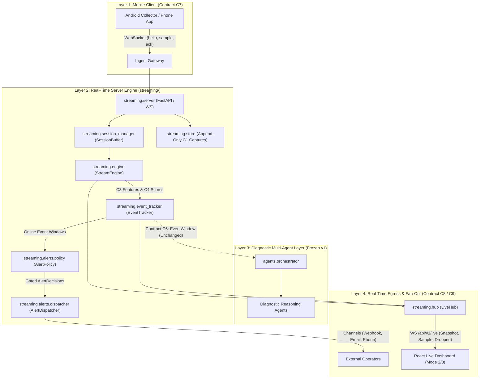
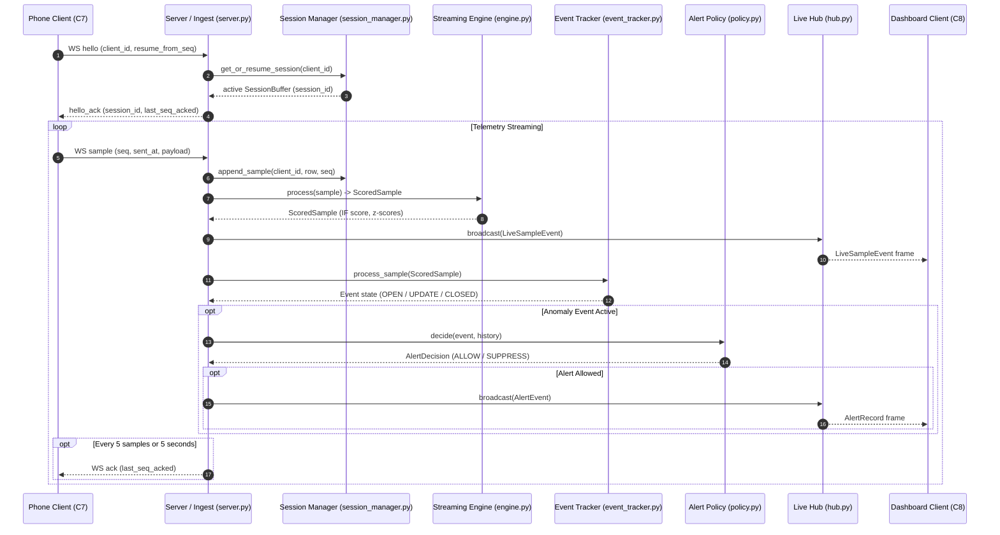

# 5G-NADS Streaming Architecture & Real-Time Data Flow (T14-014)

**Date:** 2026-10-18  
**Task:** T14-014 (Phase 14: Security, Validation, Evaluation & Release)  
**Author:** Sushil (Backend / Streaming Architecture)  
**Status:** Complete  

---

## 1. Overview & System Context

The 5G-NADS streaming architecture extends the batch telemetry evaluation pipeline (Contract C1–C6)
into a production-grade, low-latency streaming pipeline supporting real-time mobile ingestion,
online feature extraction, inference parity, event tracking, multi-channel alerting, and live
dashboard fan-out.

The streaming pipeline satisfies two core architectural commitments:
1. **Mathematical Parity:** Real-time feature calculation and anomaly scores produce identical
   results to the batch pipeline (Contract C3/C4) on identical sample windows (Guardrails G18, G25).
2. **Unchanged Diagnostic Agent Layer:** The v1 multi-agent reasoning layer (`agents/`) remains
   completely frozen and unmodified. Live event tracking adapts online event windows into the exact
   `EventWindow` contract (C6) required by the diagnostic agents.

---

## 2. Streaming Architecture Diagram

---

## 3. Streaming Data Flow Sequence

---

## 4. Module Responsibilities & Subsystem Boundaries

### 4.1 Ingest & API Gateway (`streaming.server`)
- **Transport Protocols:** Exposes authenticated WebSocket ingest (`/api/v1/ingest`), live
  dashboard fan-out (`/api/v1/live`), and REST inspection routes (`/api/v1/*`).
- **Security & Bind Exposure:** Implements loopback-only default binding (`127.0.0.1`), requiring
  `--allow-lan` and non-empty `NADS_INGEST_TOKEN` for network access (Guardrail G20).
- **Session Lifecycle:** Enforces single-use 8-character pairing codes (10-minute TTL), per-session
  ingest tokens, viewer tickets, and origin verification (Guardrails G19, G29).

### 4.2 In-Memory Session Management (`streaming.session_manager`)
- **Bounded In-Memory Buffers:** Maintains a per-client bounded `SessionBuffer` (max 2,000 rows).
- **Session Partitioning:** Enforces identical session boundaries to batch preprocessing:
  splits sessions upon 30-second timestamp gaps (`SESSION_GAP_SECONDS=30`), source file shifts,
  or buffer cap rollovers.
- **Deduplication:** Filters out redundant sequence numbers ($\text{seq} \le \text{last\_seq}$)
  without duplicating storage rows or corrupting rolling metrics.

### 4.3 Telemetry Retention & Capture Store (`streaming.store`)
- **Append-Only Captures:** Records raw mobile ingest samples directly into `data/live/` formatted
  in Contract C1 raw CSV structure with accompanying `.meta.json` sidecars.
- **Integrity Verification:** Computes SHA-256 hashes upon session completion; strictly forbids
  any writes to `data/raw/` (Guardrails G7, G22).

### 4.4 Real-Time Inference Engine (`streaming.engine`)
- **Feature Pipeline:** Replicates batch transformations (`ml/feature_engineering.py`) online:
  rolling means, rolling standard deviations (window 10), signal deltas, and persistence runs.
- **Model Inference:** Executes baseline z-score computations and Isolation Forest scoring
  using identical model artifacts and feature hash verification (Guardrail G18).
- **Missing Value Integrity:** Preserves NaN and sentinel values without coercive zero-imputation
  (Guardrail G2).

### 4.5 Windowed Event Tracker (`streaming.event_tracker`)
- **State Machine:** Groups consecutive anomalous samples into structured events, tracking
  provisional and final lifecycle states:
  - `PROVISIONAL`: Event is ongoing or has not met persistence/severity thresholds.
  - `FINAL`: Event has concluded; sample count, max severity, and duration are frozen.
- **Rule Attribution:** Evaluates heuristic rules for Radio Link Failure, Degradation, Handover,
  or Statistical Outliers without altering raw radio metrics.

### 4.6 Pure Alert Policy & Multi-Channel Dispatcher (`streaming.alerts`)
- **Gatekeeper Policy:** `streaming.alerts.policy: decide(...)` is a pure, side-effect-free
  function enforcing Rules 1–3 from `TECH_RULES_v2`:
  - Suppresses benign transitions (`NORMAL`, `CELL_TRANSITION`, `STATISTICAL_ONLY`).
  - Requires rule-based domain evidence (Guardrail G21).
  - Enforces persistence ($\ge 6$ frames) or severity thresholds, plus cooldown timers.
  - Emits one of five fixed justification strings.
- **Dispatcher & Delivery Channels:** Routes approved alerts to configured endpoints:
  - Webhook (`channels/webhook.py`): Pushes masked payload (Guardrail G26).
  - Email (`channels/email.py`): Delivers masked RFC-2822 summaries.
  - Phone Push (`channels/phone.py`): Transmits compact alerts to connected client.

### 4.7 Live Fan-Out Hub (`streaming.hub`)
- **Bounded Subscription Queues:** Broadcasts live samples, state changes, and alerts to
  connected dashboard subscribers.
- **Backpressure & Drop Protection:** Enforces bounded per-subscriber queues (default capacity 100);
  discards oldest frames when full and enqueues a `DroppedEvent` to alert clients to resync,
  preventing slow subscribers from blocking the ingest pipeline.

---

## 5. Parity Design: Real-Time vs. Batch Pipeline

To prevent divergence between batch and live execution, 5G-NADS enforces strict structural parity:

| Pipeline Stage | Batch Implementation (`ml/`) | Streaming Implementation (`streaming/`) |
|:---|:---|:---|
| **Contract C1 Input** | `data/raw/*.csv` files | Ingest `sample` messages (`schema.py`) |
| **Contract C2 Coercion** | `ml.preprocessing: clean` | `streaming.coercion: coerce` |
| **Session Splitting** | `ml.preprocessing: add_sessions` | `SessionManager: apply_session_gap` |
| **Contract C3 Features** | `ml.feature_engineering` | `StreamEngine._compute_features` |
| **Contract C4 Scoring** | `ml.anomaly_detection` | `StreamEngine.score_sample` |
| **Thresholds & Meta** | Loaded from `models/metadata.json` | Loaded from `models/metadata.json` |
| **Feature Column Hash** | Verified in `test_features.py` | Verified against `feature_hash` |

---

## 6. Preservation of the Diagnostic Agent Layer

A core architectural invariant of 5G-NADS is that **the v1 multi-agent reasoning layer (`agents/`)
is completely frozen and untouched**:

1. **No Code Modifications:** Files in `agents/` (`orchestrator.py`, `signal_agent.py`,
   `cell_agent.py`, `network_agent.py`, `diagnosis_agent.py`, `recommendation_agent.py`) contain
   zero changes between v1 and v2.
2. **Adapter Interface:** The streaming `EventTracker` constructs online event representations
   that conform strictly to the existing `EventWindow` dataclass (Contract C6).
3. **Architectural Isolation:** Reasoning agents continue to perform qualitative root-cause
   attribution, evidence collation, and hedged diagnostic text generation without importing
   `sklearn` or streaming transport dependencies (Guardrails G9, G14).

---

## 7. Decision Record Summary

The streaming architecture is governed by key architectural choices recorded in `docs/decisions.md`:

- **ADR-001 (WebSockets over Polling):** Full-duplex WebSocket connections for ingest and live
  fan-out minimize packet overhead and support server-initiated acknowledgements.
- **ADR-002 (Cumulative Ack Cadence):** Acknowledging every 5 samples or 5 seconds minimizes
  mobile radio transmission wakeups while bounding client retransmission buffers.
- **ADR-003 (Pure Alert Policy Gatekeeper):** Alert policy is implemented as an immutable,
  pure function, ensuring deterministic auditing and 100% unit-testable decision paths.
- **ADR-004 (Stateless Reboot & Resume Window):** A 600-second resume window accommodates transient
  handover drops, while stateless server reboots gracefully re-initialize sessions.
- **ADR-005 (Bounded Pub/Sub Fan-Out):** Drop-oldest queue policy guarantees that slow dashboard
  consumers cannot create backpressure that stalls upstream mobile telemetry collection.
