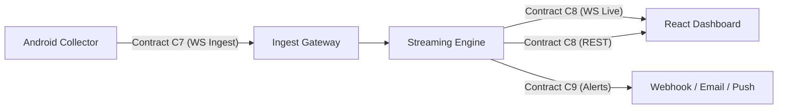

# 5G-NADS Streaming Protocol Specification (Contract C7, C8, C9)

**Date:** 2026-10-18  
**Task:** T14-013 (Phase 14: Security, Validation, Evaluation & Release)  
**Author:** Yashwant / Sushil (Backend & Streaming Infrastructure)  
**Schema Version:** 2  
**Status:** Canonical Reference  

---

## 1. Overview & Transport Topology

The 5G-NADS streaming protocol defines wire formats, state machines, and delivery semantics
for real-time telemetry ingestion, live subscriber streaming, and automated anomaly alerting:

1. **Contract C7 (Mobile Ingest Protocol):** Full-duplex WebSocket communication between field
   devices (Android app / replay harness) and the streaming ingest gateway (`/api/v1/ws/ingest`).
2. **Contract C8 (Live Client & REST API):** Server-to-dashboard WebSocket fan-out
   (`/api/v1/live`) and companion REST endpoints for session queries, history, and metrics.
3. **Contract C9 (Alert Models & Delivery):** Structured anomaly alert schema, multi-channel
   dispatch envelopes (webhook, email, phone push), and append-only audit persistence.



### Transport Specifications
- **Ingest Transport:** WebSocket over TLS (`wss://`) or plaintext WS (`ws://` on localhost).
- **Live Fan-Out Transport:** WebSocket over TLS (`wss://`) or plaintext WS (`ws://`).
- **REST Transport:** HTTPS / HTTP/1.1 with JSON request and response bodies.
- **Wire Encoding:** UTF-8 encoded JSON text frames. Binary frames are rejected (`BAD_MESSAGE`).

---

## 2. Contract C7: Mobile Ingest Protocol

### 2.1 Handshake & Authentication Sequence
1. Client connects to `/api/v1/ws/ingest?token=<BEARER_TOKEN>` or sends ticket credentials.
2. Client sends an initial `hello` frame within 5.0 seconds.
3. Server validates authorization, schema version, and session state.
4. Server responds with `hello_ack` containing operational limits and `last_seq_acked`.
5. Telemetry streaming begins with monotonic sequence numbers (`seq`).

### 2.2 Client-to-Server Ingest Messages

#### A. Ingest Hello (`hello`)
The initial connection frame announcing device capabilities, app version, and resume position.
*Source fixture: `tests/fixtures/stream/c7_ingest_hello.example.json`*

```json
{
  "android": "14",
  "app_version": "1.3.0",
  "client_id": "b1e2c3d4-test-uuid",
  "device": "Redmi 13 5G",
  "dropped_from_queue": 0,
  "edge": null,
  "manufacturer": "Xiaomi",
  "operator": "Airtel",
  "queue_depth": 0,
  "resume_from_seq": 0,
  "schema_version": 2,
  "session_label": "walk-01",
  "source": "phone",
  "type": "hello"
}
```

#### B. Ingest Sample (`sample`)
A single telemetry measurement message carrying raw radio fields (Contract C1 columns).
*Source fixture: `tests/fixtures/stream/c7_ingest_sample.example.json`*

```json
{
  "edge": null,
  "payload": {
    "android": "16",
    "csi_rsrp": null,
    "csi_rsrq": null,
    "csi_sinr": null,
    "deployment_mode": "NSA",
    "device": "SM-A156E",
    "display_override": "NR_NSA",
    "manufacturer": "samsung",
    "nci": 0,
    "network_type": "LTE",
    "nrarfcn": 629952,
    "operator": "airtel",
    "pci": 861,
    "registered": false,
    "ss_rsrp": -97.0,
    "ss_rsrq": -12.0,
    "ss_sinr": 3.0,
    "timestamp": "01-10-26 18:26:32"
  },
  "schema_version": 2,
  "sent_at": "2026-10-01T18:26:32.412+05:30",
  "seq": 119,
  "type": "sample"
}
```

#### C. Ingest Ping (`ping`)
Periodic heartbeat message sent during telemetry idle periods or low-frequency collection.
*Source fixture: `tests/fixtures/stream/c7_ingest_ping.example.json`*

```json
{
  "dropped_from_queue": 0,
  "queue_depth": 0,
  "schema_version": 2,
  "type": "ping"
}
```

#### D. Ingest Bye (`bye`)
Clean teardown notification emitted when collection is stopped by the user or client app.
*Source fixture: `tests/fixtures/stream/c7_ingest_bye.example.json`*

```json
{
  "reason": "user_stopped",
  "schema_version": 2,
  "type": "bye"
}
```

### 2.3 Server-to-Client Ingest Responses

#### A. Hello Acknowledgment (`hello_ack`)
Confirms successful session registration and declares negotiated operational boundaries.
*Source fixture: `tests/fixtures/stream/c7_hello_ack.example.json`*

```json
{
  "last_seq_acked": 100,
  "limits": {
    "max_message_bytes": 8192,
    "max_msgs_per_min": 120
  },
  "model_version": "if_v1",
  "schema_version": 2,
  "server_time": "2026-10-09T10:15:04+05:30",
  "session_id": "session-001",
  "type": "hello_ack"
}
```

#### B. Cumulative Delivery Acknowledgment (`ack`)
Confirms receipt and persistent buffering of all packets up to sequence `seq`.
*Source fixture: `tests/fixtures/stream/c7_ack.example.json`*

```json
{
  "schema_version": 2,
  "seq": 105,
  "type": "ack"
}
```

#### C. Ingest Error Notification (`error`)
Reports non-fatal validation errors or fatal protocol violations.
*Source fixture: `tests/fixtures/stream/c7_error.example.json`*

```json
{
  "code": "BAD_MESSAGE",
  "fatal": false,
  "message": "Payload invalid",
  "schema_version": 2,
  "seq": 105,
  "type": "error"
}
```

#### D. Compact Alert Push (`alert`)
Downstream alert push delivered back to the phone collector for real-time mobile display.
*Source fixture: `tests/fixtures/stream/c7_alert_push.example.json`*

```json
{
  "alert": {
    "severity": "MEDIUM",
    "title": "MEDIUM · Radio anomaly"
  },
  "schema_version": 2,
  "type": "alert"
}
```

#### E. Pong Frame (`pong`)
Heartbeat acknowledgment returning synchronized server timestamp.
*Source fixture: `tests/fixtures/stream/c7_pong.example.json`*

```json
{
  "schema_version": 2,
  "server_time": "2026-10-09T10:15:04+05:30",
  "type": "pong"
}
```

### 2.4 Ingest Delivery Semantics & Limits
- **Cumulative Acknowledgment:** Emitted automatically every **5 samples** or **5.0 seconds** of
  inactivity. Duplicate sequence packets (`seq <= last_seq_acked`) trigger an immediate `ack`.
- **Session Resume:** If connection drops, the phone re-connects sending `resume_from_seq=N`.
  If the session exists in the server buffer (within the 600-second window), the server accepts
  the reconnect and begins acknowledging from sequence `N`.
- **Sequence Gap Detection:** The server tracks sequence discontinuities. Sequence jumps up to
  `MAX_SEQ_JUMP=100` are buffered with gap metrics logged. Jumps exceeding 100 are rejected with
  `BAD_MESSAGE` (non-fatal error).
- **Ingest Limits:**
  - `max_message_bytes`: 8,192 bytes (8 KB per JSON frame).
  - `max_msgs_per_min`: 120 messages/minute (2 Hz sampling ceiling).
  - Excess rates trigger `RATE_LIMITED` errors; oversized frames trigger `TOO_LARGE`.

---

## 3. Contract C8: Live Client & REST API

### 3.1 WebSocket Live Fan-Out (`/api/v1/live`)
Dashboard clients and real-time observers connect to `/api/v1/live` for real-time telemetry.

#### First-Frame Authentication (`auth`)
Browser subscribers send a single-use viewer ticket within 5.0 seconds of establishing the WS:
```json
{
  "ticket": "ticket-a1b2c3d4e5f6",
  "type": "auth"
}
```

#### Initial State Snapshot (`snapshot`)
Sent immediately upon successful subscriber connection, conveying current state and open events.
*Source fixture: `tests/fixtures/stream/c8_snapshot.example.json` (summarized excerpt)*

```json
{
  "last_alerts": [],
  "latest_sample": {
    "anomaly_type": "NORMAL",
    "device": "SM-A156E",
    "if_score": 0.42,
    "pci": 861,
    "received_at": "2026-10-09T10:15:00+05:30",
    "sample_idx": 12,
    "seq": 119,
    "severity": "NONE",
    "ss_rsrp": -97.0,
    "ss_rsrq": -12.0,
    "ss_sinr": 3.0,
    "timestamp": "01-10-26 18:26:32"
  },
  "open_events": [],
  "schema_version": 2,
  "server_time": "2026-10-09T10:15:00+05:30",
  "session_id": "session-001",
  "state": "LIVE",
  "type": "snapshot"
}
```

#### Live Sample Broadcast (`sample`)
Broadcast for each incoming telemetry sample after inference scoring and feature derivation.
*Source fixture: `tests/fixtures/stream/c8_live_sample.example.json`*

```json
{
  "sample": {
    "anomaly_type": "NORMAL",
    "device": "SM-A156E",
    "if_flag": false,
    "if_score": 0.42,
    "is_anom": false,
    "is_valid": true,
    "model_eligible": true,
    "pci": 861,
    "published_at": "2026-10-09T10:15:00.015+05:30",
    "received_at": "2026-10-09T10:15:00.005+05:30",
    "rolling_mean_rsrp": -97.0,
    "scored_at": "2026-10-09T10:15:00.012+05:30",
    "seq": 119,
    "session_id": "session-001",
    "severity": "NONE",
    "ss_rsrp": -97.0,
    "ss_rsrq": -12.0,
    "ss_sinr": 3.0,
    "timestamp": "01-10-26 18:26:32"
  },
  "schema_version": 2,
  "server_time": "2026-10-09T10:15:00+05:30",
  "session_id": "session-001",
  "type": "sample"
}
```

#### Connection State Frame (`connection`)
Transmits connection state transitions: `LIVE`, `STALE`, `RECONNECTING`, `DISCONNECTED`.
*Source fixture: `tests/fixtures/stream/c8_connection.example.json`*

```json
{
  "last_sample_age_s": 1.5,
  "schema_version": 2,
  "server_time": "2026-10-09T10:15:00+05:30",
  "session_id": "redmi-1",
  "source": "phone",
  "state": "LIVE",
  "type": "connection"
}
```

#### Slow Subscriber Dropped Notice (`dropped`)
Informs slow subscribers when outbound queues overflow, advising resynchronization via REST.
*Source fixture: `tests/fixtures/stream/c8_dropped.example.json`*

```json
{
  "count": 10,
  "schema_version": 2,
  "server_time": "2026-10-09T10:15:05+05:30",
  "session_id": "redmi-1",
  "type": "dropped"
}
```

#### Heartbeat Notice (`heartbeat`)
Emitted periodically every 5 seconds to keep WebSocket connections alive through proxies.
*Source fixture: `tests/fixtures/stream/c8_heartbeat.example.json`*

```json
{
  "schema_version": 2,
  "server_time": "2026-10-09T10:15:05+05:30",
  "session_id": "session-001",
  "type": "heartbeat"
}
```

### 3.2 REST API Specification

| Endpoint | Method | Response Model | Description |
|---|---|---|---|
| `/healthz` | GET | `HealthResponse` | Gateway health, uptime, and version |
| `/api/v1/sessions` | GET | `SessionListResponse` | Summary list of active & historical sessions |
| `/api/v1/sessions/{id}/samples` | GET | `SamplesResponse` | Paginated scored samples for session |
| `/api/v1/sessions/{id}/events` | GET | `EventsResponse` | Diagnosed anomaly events for session |
| `/api/v1/model` | GET | `ModelInfoResponse` | Active ML model metadata and feature hash |
| `/api/v1/metrics` | GET | `MetricsResponse` | Real-time latency, drops, and queue stats |

#### REST Error Envelope
Standard error body returned on all HTTP 4xx / 5xx responses. No stack traces are ever exposed.
*Source fixture: `tests/fixtures/stream/c8_error_response.example.json`*

```json
{
  "error": {
    "code": "SESSION_NOT_FOUND",
    "correlation_id": "corr-001",
    "message": "Session session-999 not found"
  }
}
```

---

## 4. Contract C9: Alert Models & Delivery

### 4.1 Canonical Alert Record Schema
Alerts represent actionable events evaluated by `AlertPolicy` and written to `alerts.jsonl`.
*Source fixture: `tests/fixtures/stream/c9_alert_record.example.json`*

```json
{
  "acknowledged_at": null,
  "alert_id": "al-000017",
  "anomaly_type": "PERSISTENT_POOR_QUALITY",
  "body": "SINR below configured poor-quality level for 24 s; RSRQ also degraded.",
  "created_at": "2026-10-09T10:15:41+05:30",
  "delivery": [
    {
      "channel": "in_app",
      "detail": null,
      "status": "OK"
    },
    {
      "channel": "webhook",
      "detail": "timeout",
      "status": "FAILED"
    }
  ],
  "event_id": "redmi-1-e003",
  "event_status": "PROVISIONAL",
  "evidence": [
    "SS-RSRP degraded to -105 dBm"
  ],
  "kind": "NEW",
  "policy": {
    "min_persistence": 6,
    "min_severity": "MEDIUM",
    "persistence_samples": 8,
    "rule_evidence": true
  },
  "recommendation": {
    "kind": "MONITORING",
    "text": "Maintain standard telemetry"
  },
  "session_id": "redmi-1",
  "severity": "MEDIUM",
  "source": "phone",
  "title": "MEDIUM · Persistent poor radio quality (possible)"
}
```

### 4.2 Closed Alert Reasoning Strings
To prevent ambiguous notifications, all alert decisions strictly use one of five reasons:
1. `"Alert triggered"` — All threshold, severity, and rule persistence gates satisfied.
2. `"ML-only (no rule evidence)"` — Suppressed because domain rules found no anomaly evidence.
3. `"Transition only"` — Suppressed because event is a benign handover / cell reselection.
4. `"Below persistence/severity threshold"` — Suppressed due to insufficient duration.
5. `"Cooldown active"` — Suppressed because an identical alert fired within cooldown window.

### 4.3 Multi-Channel Dispatch & Privacy Gating (G26)
- **In-App / Live WebSocket:** Receives full structured `AlertRecord` for dashboard display.
- **External Webhooks:** Receives minimized payload via `to_webhook_body()`. Precise cell IDs
  (`NCI`), physical hardware IDs, and device identifiers are stripped or hashed.
- **Email:** Transmits human-readable RFC-2822 digest with sanitized event summary.
- **Phone Push:** Transmits compact Contract C7 `AlertPush` frame (`title` and `severity`).

---

## 5. Protocol Error Codes Reference

| Error Code | Codes | Meaning & Recovery Action |
|---|---|---|
| `UNAUTHORIZED` | 4001 / 401 | Missing or invalid auth token; re-authenticate |
| `VERSION_MISMATCH` | 4002 / 400 | Incompatible schema_version; upgrade client |
| `BAD_MESSAGE` | 4003 / 400 | Malformed JSON or bad discriminator; check wire format |
| `SCHEMA_ERROR` | 4004 / 422 | Field validation failure; align payload with schema |
| `RATE_LIMITED` | 4008 / 429 | Ingest rate exceeded 120/min; throttle to <=2 Hz |
| `TOO_LARGE` | 4009 / 413 | Message exceeds 8 KB; trim extra payload fields |
| `SESSION_CONFLICT` | 4010 / 409 | Duplicate client session; reconnect with new ID |
| `INTERNAL` | 4500 / 500 | Unhandled server exception; retry with backoff |

---

## 6. Versioning, Compatibility & Drift Verification

### 6.1 Semantic Evolution Rules
1. **Schema Versioning:** The wire protocol enforces `schema_version = 2`.
2. **Backward Compatibility:** Minor non-breaking additions in top-level metadata use
   `extra="ignore"`. Strict radio measurement schemas (`IngestPayload`) enforce `extra="forbid"`.
3. **Breaking Changes:** Any field removal, type change, or semantic alteration requires
   bumping `SCHEMA_VERSION` and updating client serialization fixtures.

### 6.2 Automated Drift Prevention
Contract schemas and TypeScript types are continuously validated against authoritative fixtures:
```bash
# Verify committed fixtures and TypeScript types match Pydantic schemas:
python scripts/export_contract_examples.py --check

# Execute unit and drift test suite:
pytest tests/test_contract_drift.py
```
If drift is detected, `export_contract_examples.py` regenerates canonical fixtures, and any
subsequent pull request must commit both updated schemas and documentation.
