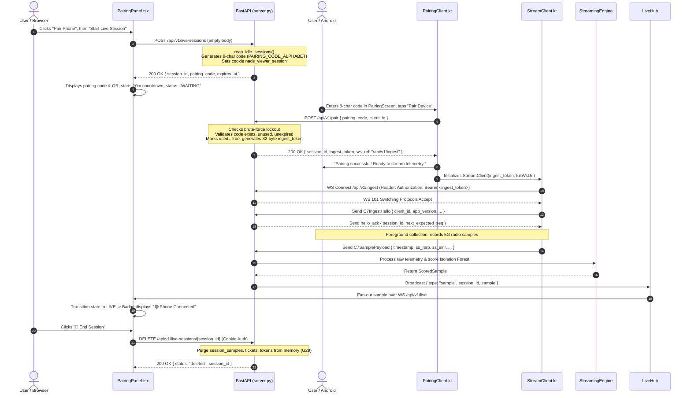

# Technical Investigation Report: Mobile Pairing & Live 5G Telemetry Flow

---

## A. Executive Summary

### 1. System Reality & Current Architecture
The system is built as a three-tier architecture:
1. **React/Vite SPA**: Hosted statically or served by FastAPI via `/app/frontend/dist`. Provides the live pairing dashboard, generates an ephemeral session, and displays an 8-character pairing code alongside an SVG QR code.
2. **FastAPI/Uvicorn Backend (`streaming/server.py`)**: Manages in-memory ephemeral pairing sessions (Contract C10), handles device pairing validation (`POST /api/v1/pair`), ingests mobile 5G telemetry via WebSocket (`WS /api/v1/ingest`), scores samples via `StreamingEngine`, and fans out scored metrics to browser viewers via WebSocket (`WS /api/v1/live`).
3. **Android Collector App (`com.example.a5gnetworktester`)**: A native Kotlin/Jetpack Compose client that collects telephony signal measurements, exchanges the 8-character code for an ephemeral ingest bearer token, and streams live metrics over WebSocket.

### 2. Most Likely Cause of the Current Failure
The error `"Server unreachable. Check your Wi-Fi, mobile network, or adb connection"` is triggered inside [PairingClient.kt:95-96](file:///d:/5G-Network-Anomaly-Detection-System/android-collector/5GNetworkTester/app/src/main/java/com/example/a5gnetworktester/PairingClient.kt#L95-L96) when a `java.io.IOException` is thrown during connection establishment. 

Three verified factors combined to cause the current failure:
1. **Vercel Hosts Only Static Assets (No Python Backend)**:
   The Vercel deployment at `https://5g-network-anomaly-detection-system.vercel.app` only deploys the compiled Vite SPA bundle (`dist/`). There is no FastAPI or Python runtime running on Vercel. Consequently, any HTTP `POST` request to `/api/v1/live-sessions` or `/api/v1/pair` against the Vercel domain fails at Vercel's edge with `HTTP 404 Not Found` (`x-vercel-error: NOT_FOUND`).
2. **Android App Loopback Binding (`localhost:8000`)**:
   In [PairingScreen.kt:51](file:///d:/5G-Network-Anomaly-Detection-System/android-collector/5GNetworkTester/app/src/main/java/com/example/a5gnetworktester/PairingScreen.kt#L51), the Server URL defaults to `"http://localhost:8000"`. On a physical Android smartphone, `localhost` resolves to `127.0.0.1` on the phone itself. Unless an active USB cable is attached with `adb reverse tcp:8000 tcp:<host_port>` active, nothing is listening on port 8000 on the phone. The phone OS immediately rejects the TCP handshake with `java.net.ConnectException: Connection refused`, which is caught as a `java.io.IOException` and reported as `"Server unreachable"`.
3. **Android Cleartext (HTTP) Security Policy Restrictions**:
   In [AndroidManifest.xml:13](file:///d:/5G-Network-Anomaly-Detection-System/android-collector/5GNetworkTester/app/src/main/AndroidManifest.xml#L13), `android:usesCleartextTraffic="false"`. Cleartext traffic is only permitted in debug builds for `localhost`, `127.0.0.1`, and `10.0.2.2` via [network_security_config.xml:4-8](file:///d:/5G-Network-Anomaly-Detection-System/android-collector/5GNetworkTester/app/src/debug/res/xml/network_security_config.xml#L4-L8). If the user attempts to enter a local LAN IP (e.g., `http://192.168.1.x:8000`), Android's OS security sandbox blocks the connection and throws `IOException: Cleartext HTTP traffic to 192.168.1.x not permitted`, triggering the exact same generic `"Server unreachable"` UI banner.

---

## B. Architecture

### 1. Component Diagram

```
 +------------------------------------------------------------------------------------------------+
 |                                  BROWSER CLIENT (DASHBOARD)                                    |
 |                                                                                                |
 |  [App.tsx]                                                                                     |
 |    |                                                                                           |
 |    +--- (1) POST /api/v1/live-sessions --------> [FastAPI Server]                              |
 |    |                                               |                                           |
 |    +--- (5) WS /api/v1/live (LiveClient.ts) <------+ (Fan-out live scored samples & events)    |
 |    |                                                                                           |
 |  [PairingPanel.tsx] Displays 8-char Code ("ABCD9876") & SVG QR Graphic                         |
 +------------------------------------------------------------------------------------------------+
                                                 |
                                                 | User inputs 8-char code
                                                 v
 +------------------------------------------------------------------------------------------------+
 |                                  ANDROID MOBILE COLLECTOR                                      |
 |                                                                                                |
 |  [PairingScreen.kt]                                                                            |
 |    |                                                                                           |
 |    +--- (2) POST /api/v1/pair -----------------> [FastAPI Server]                              |
 |         { pairing_code, client_id }                |                                           |
 |                                                    | (Returns session_id & ingest_token)       |
 |  [StreamClient.kt] <-------------------------------+                                           |
 |    |                                                                                           |
 |    +--- (3) WS /api/v1/ingest (OkHttp) --------> [FastAPI Server]                              |
 |         Authorization: Bearer <ingest_token>       |                                           |
 |         Sends: C7IngestHello, C7SamplePayload      |                                           |
 +------------------------------------------------------------------------------------------------+
                                                 |
                                                 v
 +------------------------------------------------------------------------------------------------+
 |                           FASTAPI BACKEND & INGEST SERVER (:8000)                              |
 |                                                                                                |
 |  - App State ([server.py:425-442]):                                                            |
 |      * pairing_sessions: { code -> meta } (10 min TTL)                                         |
 |      * active_live_sessions: { session_id -> meta } (Reaped after 15 min idle)                 |
 |      * session_ingest_tokens: { ingest_token -> session_id }                                   |
 |      * live_session_tickets: { ticket -> (session_id, expires_at) } (30s TTL)                  |
 |  - Telemetry Pipeline:                                                                         |
 |      * [websocket_ingest:567]: Authenticates ingest_token, parses C7 payload                    |
 |      * [StreamingEngine:1]: Coerces sample, runs Isolation Forest & rule analysis              |
 |      * [LiveHub:1669]: Dispatches scored samples to all active /api/v1/live subscribers         |
 |  - Static SPA Serving:                                                                         |
 |      * Mounts /assets and serves /app/frontend/dist/index.html with SPA 404 fallback           |
 +------------------------------------------------------------------------------------------------+
```

### 2. Component Ownership & Responsibilities

| Component | Technology | Primary Responsibilities |
| :--- | :--- | :--- |
| **Dashboard UI** | React 18, Vite, TypeScript | Displays live charts and maps; initializes pairing session (`POST /api/v1/live-sessions`); renders 8-char code and QR; manages countdown timer; triggers session termination (`DELETE /api/v1/live-sessions/{id}`). |
| **LiveClient** | TypeScript (`liveClient.ts`) | Manages dashboard WebSocket lifecycle (`/api/v1/live`); handles reconnection backoff; maintains connection state machine (`WAITING`, `LIVE`, `STALE`, `DISCONNECTED`). |
| **FastAPI Server** | Python 3.13, Starlette, Uvicorn | Single-entry HTTP/WS host; enforces bind policies and origin allow-lists; manages ephemeral session states in memory (Guardrail G29); runs real-time ML inference; serves static frontend files. |
| **StreamingEngine** | Python, Scikit-learn, Pandas | Ingests raw C7 sample dictionaries; executes incremental feature engineering, baseline scoring, and Isolation Forest scoring; emits `ScoredSample`. |
| **Android Collector** | Kotlin, Jetpack Compose | Prompts user for pairing code and server URL; executes `POST /api/v1/pair`; persists token securely in memory/Keystore; runs background foreground service collecting cell metrics. |
| **StreamClient** | Kotlin, OkHttp | Android WebSocket streaming engine; formats Contract C7 JSON messages; manages unacknowledged sample queue (`PersistentSampleQueue`) with exponential backoff reconnects. |

---

## C. Exact 8-Digit Pairing Sequence



### Detailed Step-by-Step Code Walkthrough

1. **User Action**: The dashboard user switches to `Live Mode` and clicks `Pair Phone` ([App.tsx:214](file:///d:/5G-Network-Anomaly-Detection-System/frontend/src/App.tsx#L214)), then clicks `🔗 Start Live Session` ([PairingPanel.tsx:349](file:///d:/5G-Network-Anomaly-Detection-System/frontend/src/components/PairingPanel.tsx#L349)).
2. **Session Creation**:
   - `PairingPanel.tsx` invokes `fetch(`${apiBaseUrl}/api/v1/live-sessions`, { method: 'POST' })` ([PairingPanel.tsx:193](file:///d:/5G-Network-Anomaly-Detection-System/frontend/src/components/PairingPanel.tsx#L193)).
   - `streaming/server.py` executes `create_live_session()` ([server.py:1382](file:///d:/5G-Network-Anomaly-Detection-System/streaming/server.py#L1382)).
3. **Code Generation, Expiry, and Storage**:
   - Backend calls `reap_idle_sessions()` ([server.py:1387](file:///d:/5G-Network-Anomaly-Detection-System/streaming/server.py#L1387)).
   - Validates rate limits: maximum 10 session creations per IP per 600s window ([server.py:1400](file:///d:/5G-Network-Anomaly-Detection-System/streaming/server.py#L1400)), max 5 active concurrent sessions ([server.py:1388](file:///d:/5G-Network-Anomaly-Detection-System/streaming/server.py#L1388)).
   - Generates code: `pairing_code = "".join(secrets.choice(PAIRING_CODE_ALPHABET) for _ in range(8))` ([server.py:1409-1411](file:///d:/5G-Network-Anomaly-Detection-System/streaming/server.py#L1409-L1411)). The alphabet is `23456789ABCDEFGHJKLMNPQRSTUVWXYZ` (unambiguous, no `0`, `O`, `1`, `I`) ([ml/config.py:222](file:///d:/5G-Network-Anomaly-Detection-System/ml/config.py#L222)).
   - Code TTL is 600 seconds (10 minutes) ([ml/config.py:216](file:///d:/5G-Network-Anomaly-Detection-System/ml/config.py#L216)).
   - Stores session dictionary in `app.state.pairing_sessions[pairing_code]` and `app.state.active_live_sessions[session_id]` ([server.py:1426-1427](file:///d:/5G-Network-Anomaly-Detection-System/streaming/server.py#L1426-L1427)).
   - Sets HttpOnly viewer cookie `nads_viewer_session=session_id` ([server.py:1430-1438](file:///d:/5G-Network-Anomaly-Detection-System/streaming/server.py#L1430-L1438)).
   - Returns `CreateLiveSessionResponse(session_id, pairing_code, expires_at)`.
4. **Dashboard Code Display**:
   - `PairingPanel.tsx` sets state and displays code `ABCD9876` ([PairingPanel.tsx:401](file:///d:/5G-Network-Anomaly-Detection-System/frontend/src/components/PairingPanel.tsx#L401)) and renders SVG QR finder patterns ([PairingPanel.tsx:73-138](file:///d:/5G-Network-Anomaly-Detection-System/frontend/src/components/PairingPanel.tsx#L73-L138)).
   - Countdown timer decrements seconds; if `diffSec <= 0`, marks `isExpired = true` and shows retry button ([PairingPanel.tsx:165-172](file:///d:/5G-Network-Anomaly-Detection-System/frontend/src/components/PairingPanel.tsx#L165-L172)).
5. **Mobile Code Submission**:
   - User types code into `PairingScreen.kt` and presses `Pair Device` ([PairingScreen.kt:146](file:///d:/5G-Network-Anomaly-Detection-System/android-collector/5GNetworkTester/app/src/main/java/com/example/a5gnetworktester/PairingScreen.kt#L146)).
   - Android launches a background thread calling `PairingClient.pair(pairingCode)` ([PairingScreen.kt:151-152](file:///d:/5G-Network-Anomaly-Detection-System/android-collector/5GNetworkTester/app/src/main/java/com/example/a5gnetworktester/PairingScreen.kt#L151-L152)).
   - Sends HTTP `POST {serverBaseUrl}/api/v1/pair` with JSON payload `{"pairing_code": "ABCD9876", "client_id": "com.example.a5gnetworktester"}` ([PairingClient.kt:53-72](file:///d:/5G-Network-Anomaly-Detection-System/android-collector/5GNetworkTester/app/src/main/java/com/example/a5gnetworktester/PairingClient.kt#L53-L72)).
6. **Backend Code Validation & Credential Issuance**:
   - `pair_device()` ([server.py:1446](file:///d:/5G-Network-Anomaly-Detection-System/streaming/server.py#L1446)) verifies client IP is not locked out ([server.py:1452](file:///d:/5G-Network-Anomaly-Detection-System/streaming/server.py#L1452)).
   - Looks up `app.state.pairing_sessions.get(code)`. If `None`, returns `404 Not Found`. If `used == True`, returns `409 Conflict`. If `now > expires_at`, returns `400 Bad Request` ([server.py:1483-1487](file:///d:/5G-Network-Anomaly-Detection-System/streaming/server.py#L1483-L1487)).
   - On success: marks `meta["used"] = True`, associates `client_id` ([server.py:1490-1491](file:///d:/5G-Network-Anomaly-Detection-System/streaming/server.py#L1490-L1491)).
   - Generates random 32-byte secret `ingest_token = secrets.token_urlsafe(32)` ([server.py:1495](file:///d:/5G-Network-Anomaly-Detection-System/streaming/server.py#L1495)).
   - Saves mapping `app.state.session_ingest_tokens[ingest_token] = session_id` ([server.py:1497](file:///d:/5G-Network-Anomaly-Detection-System/streaming/server.py#L1497)).
   - Returns `PairResponse(session_id, ingest_token, ws_url="/api/v1/ingest", limits)` ([server.py:1499-1504](file:///d:/5G-Network-Anomaly-Detection-System/streaming/server.py#L1499-L1504)).
7. **Mobile Credential Storage & WebSocket Ingest Connection**:
   - `PairingClient.kt` extracts `session_id`, `ingest_token`, and `ws_url` from response JSON ([PairingClient.kt:77-81](file:///d:/5G-Network-Anomaly-Detection-System/android-collector/5GNetworkTester/app/src/main/java/com/example/a5gnetworktester/PairingClient.kt#L77-L81)).
   - `PairingScreen.kt` invokes `onPairSuccess()`, storing token securely via `TokenStorage.saveIngestToken(token)` ([MainActivity.kt:158-165](file:///d:/5G-Network-Anomaly-Detection-System/android-collector/5GNetworkTester/app/src/main/java/com/example/a5gnetworktester/MainActivity.kt#L158-L165)).
   - `MainActivity.kt` invokes `initStreamClient()`: converts HTTP/HTTPS URL to `ws://` or `wss://` ([MainActivity.kt:823-828](file:///d:/5G-Network-Anomaly-Detection-System/android-collector/5GNetworkTester/app/src/main/java/com/example/a5gnetworktester/MainActivity.kt#L823-L828)) and initializes `StreamClient`.
   - `StreamClient.connect()` connects OkHttp WebSocket with `Authorization: Bearer <ingest_token>` header ([StreamClient.kt:110-115](file:///d:/5G-Network-Anomaly-Detection-System/android-collector/5GNetworkTester/app/src/main/java/com/example/a5gnetworktester/streaming/StreamClient.kt#L110-L115)).
   - Backend `websocket_ingest()` validates `token in session_tokens` ([server.py:586-597](file:///d:/5G-Network-Anomaly-Detection-System/streaming/server.py#L586-L597)) and accepts connection.
   - `StreamClient` sends `C7IngestHello` ([StreamClient.kt:183-194](file:///d:/5G-Network-Anomaly-Detection-System/android-collector/5GNetworkTester/app/src/main/java/com/example/a5gnetworktester/streaming/StreamClient.kt#L183-L194)). Backend verifies client match and replies with `hello_ack` ([server.py:657-677](file:///d:/5G-Network-Anomaly-Detection-System/streaming/server.py#L657-L677)).
8. **Dashboard Pairing Discovery**:
   - When background collection runs on phone, `CollectorForegroundService` streams `C7SamplePayload` messages over WebSocket.
   - Backend `websocket_ingest` processes samples through `StreamingEngine` and publishes `{ type: "sample", session_id, sample }` via `app.state.hub.broadcast()` ([server.py:785](file:///d:/5G-Network-Anomaly-Detection-System/streaming/server.py#L785)).
   - The browser's `LiveClient.ts` receives the message on `WS /api/v1/live` and executes `this.setState('LIVE')` ([liveClient.ts:256](file:///d:/5G-Network-Anomaly-Detection-System/frontend/src/data/liveClient.ts#L256)).
   - `PairingPanel.tsx` detects `isConnected = true` and updates badge to `"🟢 Phone Connected"` ([PairingPanel.tsx:238, 453](file:///d:/5G-Network-Anomaly-Detection-System/frontend/src/components/PairingPanel.tsx#L238)).
9. **Teardown & Cleanup**:
   - User clicks `🛑 End Session` in dashboard -> calls `DELETE /api/v1/live-sessions/{session_id}` ([PairingPanel.tsx:218](file:///d:/5G-Network-Anomaly-Detection-System/frontend/src/components/PairingPanel.tsx#L218)).
   - Backend `delete_live_session()` validates cookie auth ([server.py:1538](file:///d:/5G-Network-Anomaly-Detection-System/streaming/server.py#L1538)), purges `active_live_sessions`, `pairing_sessions`, `session_ingest_tokens`, `live_session_tickets`, and in-memory sample arrays `session_samples` and `session_events` (Guardrail G29) ([server.py:1539-1560](file:///d:/5G-Network-Anomaly-Detection-System/streaming/server.py#L1539-L1560)).

---

## D. Endpoint Contract Table

| Component | Protocol / Method | Endpoint Path | Purpose | Required Inputs | Response / Status / Auth | Source File & Line |
| :--- | :--- | :--- | :--- | :--- | :--- | :--- |
| **Dashboard** | `POST` | `/api/v1/live-sessions` | Create ephemeral pairing session & generate 8-char code | None (JSON body empty or `{}`) | `200 OK`<br>`{ session_id, pairing_code, expires_at }`<br>Sets HttpOnly cookie `nads_viewer_session` | [server.py:1382](file:///d:/5G-Network-Anomaly-Detection-System/streaming/server.py#L1382) |
| **Android** | `POST` | `/api/v1/pair` | Validate 8-char code and obtain ingest credentials | `PairRequest`: `{ pairing_code, client_id, app_version?, schema_version? }` | `200 OK`<br>`{ session_id, ingest_token, ws_url, limits }`<br>Errors: `400` (Expired), `404` (Not Found), `409` (Already used), `429` (Locked out) | [server.py:1445](file:///d:/5G-Network-Anomaly-Detection-System/streaming/server.py#L1445) |
| **Dashboard** | `POST` | `/api/v1/live-sessions/{session_id}/ticket` | Issue single-use 30s ticket for WebSocket viewer connection | `session_id` path parameter | `200 OK`<br>`{ ticket, expires_at }`<br>Auth: `nads_viewer_session` cookie or Bearer header | [server.py:1506](file:///d:/5G-Network-Anomaly-Detection-System/streaming/server.py#L1506) |
| **Dashboard** | `DELETE` | `/api/v1/live-sessions/{session_id}` | Purge ephemeral session and telemetry state from RAM | `session_id` path parameter | `200 OK`<br>`{ status: "deleted", session_id }`<br>Auth: `nads_viewer_session` cookie | [server.py:1530](file:///d:/5G-Network-Anomaly-Detection-System/streaming/server.py#L1530) |
| **Dashboard** | `GET` | `/api/v1/live-sessions/{session_id}/export.csv` | Export in-memory live stream data as Contract C1 CSV | `session_id` path parameter | `200 OK`<br>`text/csv`<br>Auth: `nads_viewer_session` cookie | [server.py:1563](file:///d:/5G-Network-Anomaly-Detection-System/streaming/server.py#L1563) |
| **Android** | `WebSocket` | `/api/v1/ingest` | Stream live mobile 5G telemetry frames | Header: `Authorization: Bearer <ingest_token>`<br>JSON frames: `hello`, `sample`, `ping` | Status: `101 Switching Protocols`<br>Emits `hello_ack`, `sample_ack`, `pong`, `error`<br>Close codes: `4401`, `1009`, `4403` | [server.py:567](file:///d:/5G-Network-Anomaly-Detection-System/streaming/server.py#L567) |
| **Dashboard** | `WebSocket` | `/api/v1/live` | Receive live fan-out scored samples and anomaly events | Public mode: First frame `{ type: "auth", ticket }`<br>Allowed `Origin` header | Status: `101 Switching Protocols`<br>Emits `snapshot`, `sample`, `event_open`, `event_update`, `heartbeat` | [server.py:1604](file:///d:/5G-Network-Anomaly-Detection-System/streaming/server.py#L1604) |
| **Dashboard** | `GET` | `/healthz` | Container healthcheck probe (non-secret status) | None | `200 OK`<br>`{ status: "ok", version: "2.0.0", uptime_s }` | [server.py:545](file:///d:/5G-Network-Anomaly-Detection-System/streaming/server.py#L545) |

---

## E. Root-Cause Analysis

### 1. Confirmed Issues (Ranked by Evidence & Confidence)

#### Issue 1: Vercel Hosting Has No Python Runtime (100% Confirmed)
- **Evidence**: The DevTools log provided by the user confirms `POST https://5g-network-anomaly-detection-system.vercel.app/api/v1/live-sessions` returned `HTTP 404 Not Found` with headers `Server: Vercel` and `x-vercel-error: NOT_FOUND`.
- **Finding**: Vercel is only configured to deploy the compiled static frontend SPA. FastAPI is not running on Vercel. Consequently, no API routes or WebSocket connections can function against `*.vercel.app`.

#### Issue 2: Android App Default Server URL Is Hardcoded to Localhost (100% Confirmed)
- **Evidence**: [PairingScreen.kt:51](file:///d:/5G-Network-Anomaly-Detection-System/android-collector/5GNetworkTester/app/src/main/java/com/example/a5gnetworktester/PairingScreen.kt#L51):
  ```kotlin
  var serverUrl by remember { mutableStateOf("http://localhost:8000") }
  ```
- **Finding**: When running on a physical Android phone, `localhost` resolves to the device itself (`127.0.0.1`). If the phone is disconnected from USB or if `adb reverse` was not executed, connecting to `localhost:8000` results in `java.net.ConnectException: Connection refused`. In [PairingClient.kt:95-96](file:///d:/5G-Network-Anomaly-Detection-System/android-collector/5GNetworkTester/app/src/main/java/com/example/a5gnetworktester/PairingClient.kt#L95-L96), this `IOException` is caught and converted directly into `PairingResult.ServerUnreachable`:
  ```kotlin
  } catch (_: java.io.IOException) {
      PairingResult.ServerUnreachable
  }
  ```
  which emits the exact user-facing message: `"Server unreachable. Check your Wi-Fi, mobile network, or adb connection."` ([PairingClient.kt:32](file:///d:/5G-Network-Anomaly-Detection-System/android-collector/5GNetworkTester/app/src/main/java/com/example/a5gnetworktester/PairingClient.kt#L32)).

#### Issue 3: Local Port Mismatch (8001 vs 8000) (100% Confirmed)
- **Evidence**: The user launched the local Docker container on `http://localhost:8001`. The Android app defaults to port `8000`.
- **Finding**: Even if `adb reverse tcp:8000 tcp:8000` was run, port 8000 on the host is closed because the Docker container was mapped to host port 8001 (`-p 8001:8000`). To reach the local container over USB, the command must be `adb reverse tcp:8000 tcp:8001` (or `serverUrl` in the app set to `http://localhost:8001` with `adb reverse tcp:8001 tcp:8001`).

#### Issue 4: Android Cleartext Traffic Blocked for LAN IPs (100% Confirmed)
- **Evidence**: [AndroidManifest.xml:13](file:///d:/5G-Network-Anomaly-Detection-System/android-collector/5GNetworkTester/app/src/main/AndroidManifest.xml#L13) has `android:usesCleartextTraffic="false"`. In [network_security_config.xml:4-8](file:///d:/5G-Network-Anomaly-Detection-System/android-collector/5GNetworkTester/app/src/debug/res/xml/network_security_config.xml#L4-L8), cleartext HTTP is permitted ONLY for:
  ```xml
  <domain includeSubdomains="true">localhost</domain>
  <domain includeSubdomains="true">127.0.0.1</domain>
  <domain includeSubdomains="true">10.0.2.2</domain>
  ```
- **Finding**: If the user tries to type their machine's Wi-Fi / LAN IP (e.g., `http://192.168.1.50:8001`), the Android OS security manager rejects the request immediately before creating a socket with `IOException: Cleartext HTTP traffic to 192.168.1.50 not permitted`. This triggers the identical `"Server unreachable"` error.

#### Issue 5: `PairingClient.kt` Masks Specific Network Exceptions (100% Confirmed)
- **Evidence**: [PairingClient.kt:95](file:///d:/5G-Network-Anomaly-Detection-System/android-collector/5GNetworkTester/app/src/main/java/com/example/a5gnetworktester/PairingClient.kt#L95) catches all `java.io.IOException` under a single umbrella:
  ```kotlin
  } catch (_: java.io.IOException) {
      PairingResult.ServerUnreachable
  }
  ```
- **Finding**: DNS resolution failure (`UnknownHostException`), connection refusal (`ConnectException`), connection timeout (`SocketTimeoutException`), TLS certificate failure (`SSLHandshakeException`), and Android cleartext policy rejection (`CleartextHttpTrafficException`) are all collapsed into the identical user-facing string `"Server unreachable. Check your Wi-Fi, mobile network, or adb connection."`. Note that if an HTTP response is actually received (e.g. 404, 400, 409, 500), `PairingClient.kt:75-94` catches the status code and reports distinct error messages. The fact that the user saw `"Server unreachable"` confirms that no HTTP response was received.

#### Issue 6: WebSocket Auth Ticket Mismatch in Public Mode (100% Confirmed)
- **Evidence**: In [server.py:1628-1635](file:///d:/5G-Network-Anomaly-Detection-System/streaming/server.py#L1628-L1635), if `config.mode == "public"`, `WS /api/v1/live` requires a first-frame ticket within 5 seconds:
  ```python
  if config.require_live_auth or config.mode == "public":
      try:
          auth_frame_text = await asyncio.wait_for(websocket.receive_text(), timeout=5.0)
  ```
  However, in [App.tsx:63-67](file:///d:/5G-Network-Anomaly-Detection-System/frontend/src/App.tsx#L63-L67), `LiveClient` is instantiated without passing a ticket or `getTicket` callback:
  ```ts
  const client = new LiveClient({
    wsUrl,
    httpBaseUrl,
    staleTimeoutMs: 15000,
  });
  ```
- **Finding**: If the backend is run with `--mode public`, the dashboard WebSocket connection to `/api/v1/live` will time out after 5 seconds and be closed by the server with code `4401 ("Auth timeout: first-frame ticket required within 5s")`.

---

### 2. Likely Issues

#### Issue 7: Loopback Access Restriction on Reverse-Proxy Ingress (High Confidence)
- **Evidence**: [server.py:1197-1203](file:///d:/5G-Network-Anomaly-Detection-System/streaming/server.py#L1197-L1203) and [server.py:1619-1623](file:///d:/5G-Network-Anomaly-Detection-System/streaming/server.py#L1619-L1623):
  ```python
  if not config.allow_remote_view:
      client_host = websocket.client.host if websocket.client else "127.0.0.1"
      if client_host not in ("127.0.0.1", "::1", "localhost", "testclient"):
          await websocket.close(code=4403, reason="Forbidden: Loopback only")
          return
  ```
- **Finding**: When deployed behind Azure Container Apps (or any cloud ingress), `client_host` is the internal proxy IP (e.g., `100.x.x.x` or `10.x.x.x`). Unless `NADS_ALLOW_REMOTE_VIEW=true` (or `--allow-remote-view`) is set, all dashboard REST read endpoints and WebSocket `/api/v1/live` will reject remote viewers with `403 Forbidden` / `4403 Loopback only`.

---

### 3. Issues Ruled Out

- **Backend / Android Schema Mismatch (Ruled Out)**:
  `PairRequest` in [streaming/schema.py:799-807](file:///d:/5G-Network-Anomaly-Detection-System/streaming/schema.py#L799-L807) requires `pairing_code` and `client_id`, with optional `app_version` and `schema_version`. `PairingClient.kt:67` sends exactly `{"pairing_code":"...","client_id":"..."}`. The contract is 100% compatible.
- **CORS / Origin Blocking Mobile Pairing (Ruled Out)**:
  [OriginEnforcementMiddleware:276-300](file:///d:/5G-Network-Anomaly-Detection-System/streaming/server.py#L276-L300) checks `origin = request.headers.get("origin")`. Mobile Android native HTTP requests (`HttpURLConnection`) do not send an `Origin` header. The middleware passes requests without an `Origin` header directly to `call_next(request)`.
- **Missing Ingest Token on Initial Pair (Ruled Out)**:
  `POST /api/v1/pair` is an unauthenticated credential issuance endpoint. It does not require a prior Bearer token.
- **Missing `agents/` Directory in Container (Ruled Out for User's Current Build)**:
  The user confirmed adding `COPY agents/ ./agents/` in line 44 of `Dockerfile`, resolving the initial `ModuleNotFoundError`.

---

## F. Docker and Azure Deployment Readiness

### 1. Single Container Dual Serving
- **Status**: **Supported**.
- **Evidence**:
  - In [Dockerfile:46](file:///d:/5G-Network-Anomaly-Detection-System/Dockerfile#L46), compiled frontend SPA assets are copied: `COPY --from=frontend-builder /app/frontend/dist ./frontend/dist`.
  - In [Dockerfile:23](file:///d:/5G-Network-Anomaly-Detection-System/Dockerfile#L23), `ENV NADS_STATIC_DIR=/app/frontend/dist`.
  - In [server.py:1736-1765](file:///d:/5G-Network-Anomaly-Detection-System/streaming/server.py#L1736-L1765), if `NADS_STATIC_DIR` exists, FastAPI mounts `/assets` and `/data` and serves `index.html` at `/`.
  - In [server.py:461-485](file:///d:/5G-Network-Anomaly-Detection-System/streaming/server.py#L461-L485), the 404 exception handler serves `index.html` for any client route that does not start with `/api/` or `/ws/`, allowing client-side React SPA routing to function correctly.

### 2. Azure Container Apps Ingress Requirements
To run on Azure Container Apps with HTTPS ingress on internal port 8000:
- **Target Port**: `8000`
- **Ingress**: `External` (Accepting traffic from anywhere)
- **Transport**: `Auto` or `HTTP/1.1` (Azure Envoy automatically handles WebSocket upgrade headers `Upgrade: websocket` and `Connection: Upgrade`)

### 3. Environment Variables & Startup Validation
When `host` is set to `0.0.0.0` (mandatory for containers to accept inbound external traffic), [ServerConfig.validate():180-192](file:///d:/5G-Network-Anomaly-Detection-System/streaming/server.py#L180-L192) and [main():1848-1863](file:///d:/5G-Network-Anomaly-Detection-System/streaming/server.py#L1848-L1863) enforce strict security guardrails:

| Variable | Required in Azure | Value / Setting | Exact Function & What It Controls |
| :--- | :--- | :--- | :--- |
| `NADS_HOST` | **Yes** | `0.0.0.0` | Binds server to all container network interfaces. |
| `NADS_PORT` | **Yes** | `8000` | Port uvicorn listens on inside the container. |
| `NADS_ALLOW_LAN` | **Yes** | `true` | **Mandatory** when `host != 127.0.0.1`. If not `true`, server exits immediately with code 2 ([server.py:1851](file:///d:/5G-Network-Anomaly-Detection-System/streaming/server.py#L1851)). |
| `NADS_INGEST_TOKEN` | **Yes** | `<random-secret-string>` | **Mandatory** when `host != 127.0.0.1`. Fulfills Guardrail G20 bind policy ([server.py:1857](file:///d:/5G-Network-Anomaly-Detection-System/streaming/server.py#L1857)). Also acts as fallback bearer token. |
| `NADS_ALLOW_REMOTE_VIEW` | **Yes** | `true` | **Mandatory** for cloud deployment. When `false`, all REST read endpoints and `WS /api/v1/live` reject remote proxy requests with `403 Loopback only` ([server.py:1197, 1619](file:///d:/5G-Network-Anomaly-Detection-System/streaming/server.py#L1197)). |
| `NADS_MODE` | **Yes** | `local` (Recommended for Azure single-container) | In `local` mode, `WS /api/v1/live` does not require first-frame auth tickets (which `App.tsx` does not currently provide). If set to `public`, `NADS_ALLOWED_ORIGINS` is required and `App.tsx` must be patched to pass tickets. |
| `NADS_ENABLE_RETENTION` | **Yes** | `false` | Disables disk retention of live session telemetry to satisfy ephemeral privacy Guardrail G29 ([server.py:173-177](file:///d:/5G-Network-Anomaly-Detection-System/streaming/server.py#L173-L177)). |
| `NADS_ALLOWED_ORIGINS` | Conditional | `https://<app-name>.<region>.azurecontainerapps.io` | Required if `NADS_MODE=public`. Controls CORS headers and WebSocket Origin checks. Wildcards (`*`) are rejected in public mode ([server.py:168](file:///d:/5G-Network-Anomaly-Detection-System/streaming/server.py#L168)). |

### 4. Reverse Proxy Trust & Client IP
In [server.py:1394, 1448](file:///d:/5G-Network-Anomaly-Detection-System/streaming/server.py#L1394), the server extracts the client IP via `request.client.host`. Behind Azure Container Apps Envoy proxy:
- Without uvicorn proxy headers enabled, `request.client.host` reflects the internal Azure proxy IP, not the end-user's phone or browser IP.
- Because `NADS_ALLOW_REMOTE_VIEW=true` disables the loopback check, requests are permitted.
- However, IP-based rate limiters (`ip_session_creations`, `pairing_failed_attempts`) will aggregate across clients sharing that proxy connection.

### 5. Android Support for Azure HTTPS / WSS
- **Supported Out of the Box**:
  - Azure Container Apps provides a valid public TLS certificate for `https://<app>.azurecontainerapps.io`.
  - Android native `HttpURLConnection` automatically validates the certificate against Android's system CA trust store.
  - In [MainActivity.kt:825](file:///d:/5G-Network-Anomaly-Detection-System/android-collector/5GNetworkTester/app/src/main/java/com/example/a5gnetworktester/MainActivity.kt#L825):
    ```kotlin
    val wsScheme = if (cleanServer.startsWith("https")) "wss" else "ws"
    ```
    If the server URL begins with `https://`, the WebSocket scheme automatically switches to `wss://`.
  - OkHttp natively handles WSS over TLS port 443.

---

## G. Android Changes Required

### 1. Does Android Code Require Mandatory Changes for Azure?
**No mandatory code changes are required for Android to connect to Azure over HTTPS**, provided the user enters the Azure HTTPS URL into the app's `Server Base URL` input field.

### 2. Recommended Android Improvements (for UX & Field Testing)
1. **Change Default Server URL**:
   - **File**: [PairingScreen.kt:51](file:///d:/5G-Network-Anomaly-Detection-System/android-collector/5GNetworkTester/app/src/main/java/com/example/a5gnetworktester/PairingScreen.kt#L51)
   - **Current**: `var serverUrl by remember { mutableStateOf("http://localhost:8000") }`
   - **Recommendation**: Update default to the hosted Azure URL (e.g. `https://<app-name>.<region>.azurecontainerapps.io`) or persist the last-entered URL in `SharedPreferences` so field testers walking around don't have to retype the URL every launch.
2. **Expose Detailed Error Messages in `PairingClient.kt`**:
   - **File**: [PairingClient.kt:95-98](file:///d:/5G-Network-Anomaly-Detection-System/android-collector/5GNetworkTester/app/src/main/java/com/example/a5gnetworktester/PairingClient.kt#L95-L98)
   - **Current**: Collapses all `IOException` into `PairingResult.ServerUnreachable`.
   - **Recommendation**: Differentiate `java.net.ConnectException` (port closed/no listener), `UnknownHostException` (bad hostname/DNS), `SocketTimeoutException` (timeout), and `CleartextHttpTrafficException` (cleartext forbidden) to provide clear diagnosis in the UI banner.
3. **LAN Cleartext Allowance (Optional for Local Wi-Fi Testing Only)**:
   - **File**: [network_security_config.xml:4-8](file:///d:/5G-Network-Anomaly-Detection-System/android-collector/5GNetworkTester/app/src/debug/res/xml/network_security_config.xml#L4-L8)
   - **Finding**: Currently restricts cleartext to `localhost`, `127.0.0.1`, `10.0.2.2`. If testing over Wi-Fi without HTTPS or ADB reverse is ever required, the local subnet or cleartext permissions must be configured. (Not required for Azure HTTPS).

---

## H. Prioritized Action Plan

### Phase 1: Verify Locally via ADB Reverse (Zero Code Changes)
1. Confirm local Docker container is running on host port 8001:
   ```powershell
   curl http://localhost:8001/healthz
   ```
2. Connect the Android phone via USB with USB debugging enabled.
3. Run `adb reverse` to forward port 8000 on the phone to port 8001 on the host:
   ```bash
   adb reverse tcp:8000 tcp:8001
   ```
4. On the PC browser, open `http://localhost:8001`. Switch to **Live Mode**, click **Pair Phone**, and click **Start Live Session**. Note the 8-character code.
5. On the phone, open the app, navigate to **Pairing**, leave the server URL as `http://localhost:8000`, enter the 8-character code, and tap **Pair Device**.
6. **Expected Result**: Pairing succeeds, phone switches to Home screen, and dashboard transitions to `🟢 Phone Connected` as soon as collection starts.

---

### Phase 2: Prepare Repository & Dockerfile
1. **Ensure `COPY agents/ ./agents/` is permanently present in `Dockerfile`**:
   - In [Dockerfile:44](file:///d:/5G-Network-Anomaly-Detection-System/Dockerfile#L44), ensure Stage 2 includes `COPY agents/ ./agents/`.
2. **Review Default Docker CMD / Entrypoint**:
   - In [Dockerfile:61](file:///d:/5G-Network-Anomaly-Detection-System/Dockerfile#L61), the default is `CMD ["--host", "0.0.0.0", "--port", "8000", "--mode", "public"]`.
   - To avoid startup crashes without extra arguments, configure the environment variables below in the Azure Container App configuration.

---

### Phase 3: Deploy to Azure Container Apps
1. **Build and Push Container Image**:
   Build the multi-stage Docker image and push to Azure Container Registry (ACR):
   ```bash
   az acr build --registry <your-acr-name> --image 5g-nads:latest .
   ```
2. **Deploy Container App with Ingress & Environment Variables**:
   Deploy the container with internal port 8000 and the required runtime environment variables:
   ```bash
   az containerapp create \
     --name nads-telemetry \
     --resource-group <your-resource-group> \
     --environment <your-environment-name> \
     --image <your-acr-name>.azurecr.io/5g-nads:latest \
     --target-port 8000 \
     --ingress external \
     --env-vars \
       NADS_HOST="0.0.0.0" \
       NADS_PORT="8000" \
       NADS_ALLOW_LAN="true" \
       NADS_ALLOW_REMOTE_VIEW="true" \
       NADS_INGEST_TOKEN="nads-prod-secret-ingest-token-2026" \
       NADS_MODE="local" \
       NADS_ENABLE_RETENTION="false"
   ```
   *(Note: Setting `NADS_MODE="local"` in combination with `NADS_ALLOW_REMOTE_VIEW="true"` allows remote viewers to access the dashboard and WebSocket `/api/v1/live` without requiring ticket auth, which is currently unconfigured in `App.tsx`)*.
3. **Verify Deployment Health**:
   ```bash
   curl -i https://<app-name>.<region>.azurecontainerapps.io/healthz
   ```
   Expected response: `HTTP/2 200` with `{"status":"ok","version":"2.0.0",...}`.
4. **Verify SPA Dashboard**:
   Open `https://<app-name>.<region>.azurecontainerapps.io/` in any browser. The dashboard loads directly from the FastAPI container.

---

### Phase 4: Walk-Around 5G Mobile Ingestion (No USB Cable, No Wi-Fi)
1. On the dashboard at `https://<app-name>.<region>.azurecontainerapps.io`, click **Pair Phone** -> **Start Live Session**.
2. On the Android phone (on pure 5G/4G cellular data, Wi-Fi disabled, USB disconnected):
   - Open the app -> **Pairing**.
   - In **Server Base URL**, enter:
     `https://<app-name>.<region>.azurecontainerapps.io`
   - Enter the 8-character code.
   - Tap **Pair Device**.
3. **Result**:
   - `PairingClient` sends `POST https://.../api/v1/pair`.
   - Phone receives token and transitions to Home screen.
   - Tap **Start Recording** / **Start Collection**.
   - `StreamClient` establishes `wss://.../api/v1/ingest`.
   - Dashboard receives live samples and updates status to `🟢 Phone Connected`.
   - You can walk around untethered while streaming live 5G cellular metrics.

---

## I. Evidence

### 1. Codebase File Paths & Line Citations

| Subsystem | File & Lines | Symbol / Function | Verification Note |
| :--- | :--- | :--- | :--- |
| **Android Pairing URL** | [PairingScreen.kt:51](file:///d:/5G-Network-Anomaly-Detection-System/android-collector/5GNetworkTester/app/src/main/java/com/example/a5gnetworktester/PairingScreen.kt#L51) | `var serverUrl` | Hardcoded default `"http://localhost:8000"`. |
| **Android Network Error** | [PairingClient.kt:95-96](file:///d:/5G-Network-Anomaly-Detection-System/android-collector/5GNetworkTester/app/src/main/java/com/example/a5gnetworktester/PairingClient.kt#L95-L96) | `catch (_: IOException)` | Converts all `IOException` to `PairingResult.ServerUnreachable`. |
| **Android Cleartext Policy** | [AndroidManifest.xml:13](file:///d:/5G-Network-Anomaly-Detection-System/android-collector/5GNetworkTester/app/src/main/AndroidManifest.xml#L13) | `usesCleartextTraffic` | Value is `"false"`. |
| **Android Whitelist** | [network_security_config.xml:4-8](file:///d:/5G-Network-Anomaly-Detection-System/android-collector/5GNetworkTester/app/src/debug/res/xml/network_security_config.xml#L4-L8) | `<domain-config>` | Only `localhost`, `127.0.0.1`, and `10.0.2.2` permitted in debug. |
| **Android WSS Construction** | [MainActivity.kt:824-828](file:///d:/5G-Network-Anomaly-Detection-System/android-collector/5GNetworkTester/app/src/main/java/com/example/a5gnetworktester/MainActivity.kt#L824-L828) | `initStreamClient()` | Automatically translates `https://` to `wss://`. |
| **Dashboard API URL** | [PairingPanel.tsx:142, 193](file:///d:/5G-Network-Anomaly-Detection-System/frontend/src/components/PairingPanel.tsx#L142) | `handleStartSession()` | `apiBaseUrl` defaults to `""`. Resolves relative to browser origin. |
| **Dashboard WebSocket URL** | [App.tsx:58-61](file:///d:/5G-Network-Anomaly-Detection-System/frontend/src/App.tsx#L58-L61) | `AppContent` | Translates `https:` to `wss:` and targets `/api/v1/live`. |
| **Dashboard Ticket Gap** | [App.tsx:63-67](file:///d:/5G-Network-Anomaly-Detection-System/frontend/src/App.tsx#L63-L67) | `new LiveClient(...)` | Ticket parameter omitted. Fails in `public` mode. |
| **Backend Session Creation** | [server.py:1382-1443](file:///d:/5G-Network-Anomaly-Detection-System/streaming/server.py#L1382-L1443) | `create_live_session()` | Issues 8-char code with 600s TTL and cookie. |
| **Backend Device Pairing** | [server.py:1445-1505](file:///d:/5G-Network-Anomaly-Detection-System/streaming/server.py#L1445-L1505) | `pair_device()` | Issues 32-byte `ingest_token`, marks code `used=True`. |
| **Backend Bind Policy** | [server.py:180-192](file:///d:/5G-Network-Anomaly-Detection-System/streaming/server.py#L180-L192) | `ServerConfig.validate()` | Requires `allow_lan` and `ingest_token` when host is not loopback. |
| **Backend Loopback Guard** | [server.py:1195-1204, 1619](file:///d:/5G-Network-Anomaly-Detection-System/streaming/server.py#L1195-L1204) | `verify_loopback_access()` | Closes with 403 unless `allow_remote_view=True`. |
| **Backend Static Serving** | [server.py:1736-1765](file:///d:/5G-Network-Anomaly-Detection-System/streaming/server.py#L1736-L1765) | `create_app()` | Mounts `/assets` and serves `/` from `NADS_STATIC_DIR`. |
| **Backend Agent Import** | [event_tracker.py:18](file:///d:/5G-Network-Anomaly-Detection-System/streaming/event_tracker.py#L18) | Import statement | `from agents.orchestrator import ...` requires `agents/` in Docker. |

---

### 2. Existing Test Coverage Matrix

| Test Suite | File | Tests Covered |
| :--- | :--- | :--- |
| **C10 Pairing API Lifecycle** | [tests/test_pairing_session_api.py](file:///d:/5G-Network-Anomaly-Detection-System/tests/test_pairing_session_api.py) | - `test_create_live_session_and_cookie`<br>- `test_pairing_flow_and_single_use` (409 on reuse)<br>- `test_expired_pairing_code_rejected` (400 on expiry)<br>- `test_invalid_pairing_code_rejected` (404 on missing)<br>- `test_websocket_ingest_with_per_session_token`<br>- `test_ticket_and_delete_live_session` (G29 memory purge) |
| **WebSocket Auth & Tickets** | [tests/test_per_session_ws_auth.py](file:///d:/5G-Network-Anomaly-Detection-System/tests/test_per_session_ws_auth.py) | - `test_token_session_a_cannot_write_session_b`<br>- Reused or late ticket rejected (4401)<br>- First-frame ticket timeout after 5s (4401) |
| **Origin & CORS Enforcement** | [tests/test_origin_cors.py](file:///d:/5G-Network-Anomaly-Detection-System/tests/test_origin_cors.py) | - `test_rest_allowed_origin_succeeds_with_cors_headers`<br>- `test_rest_disallowed_origin_refused_with_403`<br>- `test_rest_options_preflight_cors_enforcement`<br>- `test_ws_live_disallowed_origin_closed_with_4403`<br>- `test_ws_live_missing_origin_in_public_mode_refused` |
| **Pairing Abuse & Rate Limits** | [tests/test_security_pairing_limits.py](file:///d:/5G-Network-Anomaly-Detection-System/tests/test_security_pairing_limits.py) | - Brute-force guessing triggers 429 lockout<br>- Session creation IP flooding rate limit (429)<br>- Frame size limit (1009) |
| **Bind & Exposure Policy** | [tests/test_bind_exposure_policy.py](file:///d:/5G-Network-Anomaly-Detection-System/tests/test_bind_exposure_policy.py) | - Default loopback 127.0.0.1<br>- Non-loopback without `--allow-lan` exits 2<br>- Non-loopback without token exits 2<br>- Remote viewers refused 403 unless `allow_remote_view` |
| **Frontend Pairing UI** | [frontend/src/components/PairingPanel.test.tsx](file:///d:/5G-Network-Anomaly-Detection-System/frontend/src/components/PairingPanel.test.tsx) | - Initial state with Start button and privacy notice<br>- Code display, QR SVG, and countdown timer<br>- 10-minute code expiration transition and retry action<br>- Ephemeral CSV build and download |
| **Android Pairing Client** | [PairingClientTest.kt](file:///d:/5G-Network-Anomaly-Detection-System/android-collector/5GNetworkTester/app/src/test/java/com/example/a5gnetworktester/PairingClientTest.kt) | - Distinct user-facing message per failure code (400, 404, 409, 429, unreachable)<br>- Token never present in user-facing error strings<br>- Unreachable server maps to `PairingResult.ServerUnreachable` |

### 3. Safe Verification Test Command
To verify that all pairing, security, origin, and session lifecycle tests pass in the current repository without running any server or modifying any files:
```powershell
pytest tests/test_pairing_session_api.py tests/test_per_session_ws_auth.py tests/test_origin_cors.py tests/test_bind_exposure_policy.py -v
```